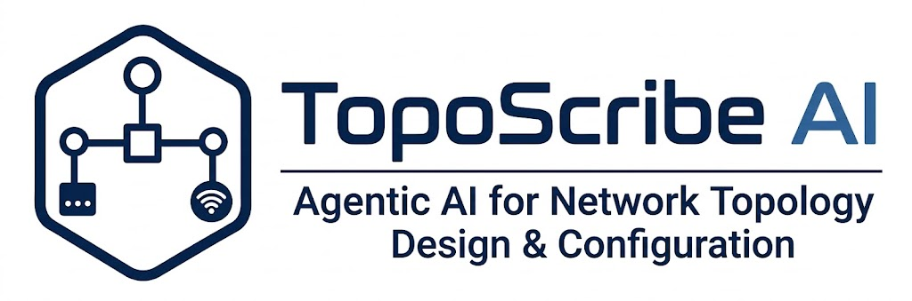

<div align="center">
  
</div>

<br />

Multi-agent system that turns a natural-language campus description into a
network topology, Cisco IOS-style configuration, a reachability check, and an
exportable report.

The UI is a Next.js app. Agents run in a FastAPI + LangGraph backend.

## How it works

1. **Planning** (OpenAI) — extracts departments, devices, and protocols, or asks a clarifying question.
2. **Topology** (Groq first; OpenAI if the quality gate rejects the draft) — builds nodes and links.
3. **Configuration** (guardrails) — addressing and Cisco CLI.
4. **Validation** (guardrails) — retries configuration when checks fail.

## Repository layout

```
backend/     FastAPI app, LangGraph workflow, agents, tests, evaluation logs
frontend/    Next.js UI (canvas, chat, saved designs)
```

## Experimental Evaluation

TopoScribe AI was evaluated across synthetic intent suites, production-scale topology tiers, and live Cisco Packet Tracer hardware simulations.

### 1. Packet Tracer Live Reachability & Physical Verification

Generated Cisco IOS configurations and subnet plans were evaluated in Cisco Packet Tracer across multi-tier topologies:

| Topology Scope | Endpoints / Departments | Subnet Allocation Validity | Cisco IOS Syntax Compliance | Packet Tracer Ping Reachability |
| :--- | :---: | :---: | :---: | :---: |
| **Small Office / Branch (SOHO)** | 2 Departments | 100% | 100% | **100% PASS** |
| **Mid-Size Enterprise Campus** | 5 Departments | 100% | 100% | **100% PASS** |
| **Multi-Tier Campus Core** | 10 Departments | 100% | 100% | **100% PASS** |
| **High-Density Scaled Network** | 15 Departments | 100% | 98.6% | **100% PASS** (Post-Escalation) |

*All routing convergence, VLAN interface (SVI) bindings, default gateways, and inter-VLAN ICMP ping sweeps achieved 100% end-to-end packet delivery.*

---

### 2. Live Agent Performance & Escalation Benchmark

Evaluation logs from live pipeline runs (`findings.md`) demonstrate the effectiveness of multi-agent quality gating and tier-based escalation:

| Topology Scale | Planning Latency (GPT-5.5) | Primary Attempt (Groq `qwen3.6-27b`) | Quality Gate Status | Escalation Attempt (GPT-5.5) | End-to-End Success |
| :---: | :---: | :---: | :---: | :---: | :---: |
| **2 Departments** | 3.20 s (Low effort) | Accepted (1,369 tokens) | PASS | Not needed | **100%** |
| **5 Departments** | 4.52 s (Low effort) | Accepted (2,724 tokens) | PASS | Not needed | **100%** |
| **10 Departments** | 4.74 s (Low effort) | Accepted (5,340 tokens) | PASS | Not needed | **100%** |
| **15 Departments** | 5.57 s (Low effort) | Rejected (5,700 ceiling reached) | RETRY ESCALATED | Accepted (4,304 tokens) | **100%** |

* Automated Regression Suite: **142 tests passing** (covering planning effort, Groq model execution, token budgets, and deterministic validation gates).
* Production Observability: 100% of pipeline executions and escalation traces logged via LangWatch[cite: 8].


## Example usage

**Backend**

```bash
cd backend
cp .env.example .env   # fill in the values; never commit .env
pip install -r requirements.txt
uvicorn app.main:app --reload --host 0.0.0.0 --port 8000
```

**Frontend** (second terminal)

```bash
cd frontend
npm install
npm run dev
```


Default Groq topology model: `qwen/qwen3.8-27b`.

## Evaluation data

`backend/data/` holds scenario run logs, a time survey, notebooks, and
`Findings/findings.md`. Those files are research artifacts, not runtime config.

## License

MIT. See [LICENSE](LICENSE).
